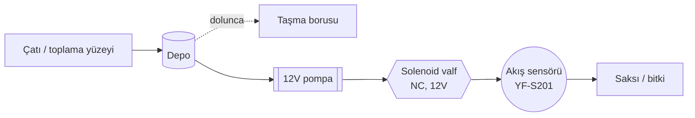
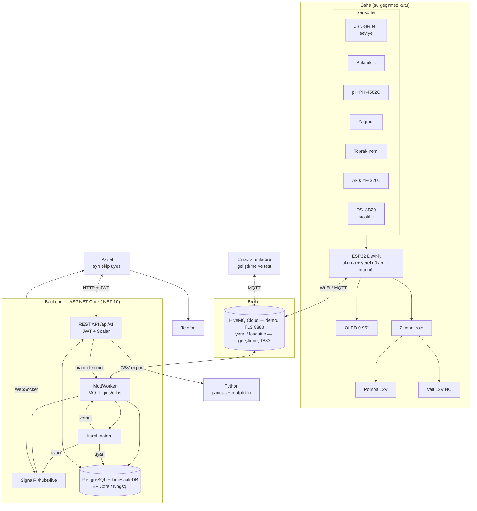
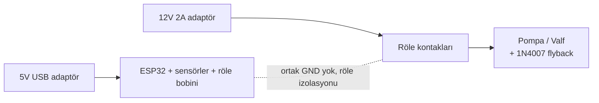

# Sistem Mimarisi — Akıllı Yağmur Suyu Hasat Sistemi

> Taslak v0.1. Varsayımlar en altta. Onaylanınca pin planı ve MQTT sözleşmesi kesinleşecek.

## 1. Fiziksel su akışı



- **Valf çıkışta**, pompadan sonra durur. Sulama hattını açıp kapatır. Normalde kapalı (NC) olduğu için pompa dururken sifonlama ya da sızıntıyla depo boşalmaz.
- **Pompa** depodaki suyu, toprak kuru olduğunda valf üzerinden saksıya basar. Pompa basınç sağladığı için ucuz, pilot kumandalı solenoid valfler de sorunsuz açılır.
- **Sulama sırası:** valf aç → pompa çalıştır → pompa durdur → valf kapat. Pompa hiçbir zaman kapalı valfe karşı çalışmaz (bkz. §3, kilitleme).
- **Su kalitesi** depodaki suda ölçülür. Su kötüyse sulama engellenir ve uyarı verilir. Kirli suyu depoya girmeden reddetmek bu düzende mümkün değil.
- **Taşma** pasif bir taşma borusuyla çözülür, elektronik kontrol gerekmez.
- **Akış sensörü** valf çıkışında durur ve kullanılan litreyi ölçer. Toplanan litre, depo seviyesindeki değişimden hesaplanır.

## 2. Katmanlar



| Katman | Bileşen | Görev |
|---|---|---|
| Algılama | 7 sensör | Ham ölçüm |
| Kenar (edge) | ESP32 firmware | Okuma, filtreleme, kalibrasyon, **güvenlik kilitleri**, MQTT yayını |
| Eyleyici | Röle + pompa + valf | Fiziksel kontrol |
| İletişim | HiveMQ Cloud (demo), Mosquitto (geliştirme) | Kimlik doğrulamalı mesajlaşma |
| Backend | ASP.NET Core, .NET 10 | Kayıt, üst seviye kurallar, REST + SignalR API, JWT, uyarılar. Ayrıntı: [backend/PLAN.md](backend/PLAN.md) |
| Sunum | Panel (ayrı ekip üyesi) | Backend API'sini kullanan arayüz |
| Analiz | Python | Su tasarrufu raporları ve grafikler (backend'in CSV dışa aktarımıyla) |

> Not: İlk ihtiyaç listesi ([requirements.md](requirements.md)) backend için Node-RED öneriyordu. Bunun yerine .NET ile kendi backend'imizi yazmaya karar verdik.

## 3. Kontrol mantığı nerede çalışır?

**Temel ilke:** Bağlantı koptuğunda sistemi güvenli tutan kurallar ESP32'de, keyfe bağlı ve değiştirilebilir kurallar backend'de çalışır.

| Kural | Yer | Neden |
|---|---|---|
| Depo boşsa pompayı durdur (kuru çalışma koruması) | **ESP32** | Pompa yanabilir, internete bağımlı olmamalı |
| **Kilitleme:** valf kapalıyken pompa çalışmaz; pompa durmadan valf kapanmaz | **ESP32** | Pompa kapalı hatta basarsa zarar görür |
| Su kirliyse sulamayı engelle | **ESP32** (eşikler backend'den güncellenebilir) | Bitkiye kirli su verilmesin |
| Pompa en fazla N dakika çalışsın (watchdog) | **ESP32** | Komut kaybolursa sonsuza dek çalışmasın |
| MQTT koparsa: pompa kapalı, valf kapalı | **ESP32** | Fail-safe |
| Toprak kuruysa sula | Backend (ESP32'de yedek kural) | Eşik ve saat ayarı panelden değişsin |
| Manuel sulama / pompa / valf komutları | Backend → ESP32 | ESP32 güvenlik kurallarına göre reddedebilir |
| Uyarılar, kayıt | Backend | |

Valfin **normalde kapalı (NC)** olması, elektrik kesildiğinde sulama hattının kapalı kalması ve deponun boşalmaması demek. Bu doğru güvenli durumdur.

## 4. MQTT sözleşmesi (taslak)

> **Güncel ve bağlayıcı sürüm:** [backend/docs/mqtt.md](backend/docs/mqtt.md). Bu bölüm yalnızca genel bakış içindir.

Kök: `rainwater/<deviceId>/...` — örneğin `rainwater/node1/...`

| Topic | Yön | QoS / Retain | İçerik |
|---|---|---|---|
| `.../telemetry` | ESP32 → | 0 / hayır | Her 10 s, tüm sensörler (JSON) |
| `.../state` | ESP32 → | 1 / evet | Pompa/valf durumu, mod, son hata |
| `.../status` | ESP32 → | 1 / evet | `online` / `offline` (LWT) |
| `.../cmd` | → ESP32 | 1 / hayır | `{"commandId":"…","action":"irrigate","durationS":60}` (sıralamayı cihaz yapar), bakım için `{"commandId":"…","actuator":"valve","action":"open"}` |
| `.../config` | → ESP32 | 1 / evet | Eşikler: pH aralığı, bulanıklık limiti, seviye limitleri |

Telemetri örneği:

```json
{
  "ts": 1763800000,
  "levelPct": 64.2,
  "levelCm": 38.5,
  "turbidityNtu": 12.0,
  "ph": 6.9,
  "waterTempC": 18.4,
  "raining": true,
  "soilPct": 31,
  "flowLpm": 0.0,
  "flowTotalL": 142.7,
  "rssi": -61
}
```

## 5. Güç alanları



- 12V tarafı yalnızca röle kontakları üzerinden geçer. ESP32'ye hiç dokunmaz.
- Diyotlar pompa ve valfin **uçlarına ters paralel** bağlanır (röleye değil).

## 6. Taslak pin planı

| Sinyal | GPIO | Not |
|---|---|---|
| pH (analog) | 34 | 5V → bölücü (10k/20k) |
| Bulanıklık (analog) | 35 | 5V → bölücü |
| Toprak nemi (analog) | 32 | 3.3V ile beslenirse bölücü gerekmez |
| Yağmur (analog AO) | 33 | 3.3V ile beslenebilir |
| JSN-SR04T TRIG | 25 | 3.3V tetik genelde yeterli |
| JSN-SR04T ECHO | 36 (VP, yalnız giriş) | 5V → bölücü |
| Akış sensörü pulse | 39 (VN, yalnız giriş) | 5V → bölücü, kesme (interrupt) |
| DS18B20 data | 4 | **4.7 kΩ pull-up gerekli** |
| Röle IN1 (pompa) | 26 | |
| Röle IN2 (valf) | 27 | |
| OLED SDA / SCL | 21 / 22 | I²C |

Strapping pinleri (0, 2, 12, 15) ve flash pinleri (6–11) kullanılmıyor.

## 7. Listeye eklenmesi gerekenler

- **4.7 kΩ direnç**: DS18B20 için pull-up
- **Röle modülü**: 3.3V tetiklenebilen (optokuplörlü, "high/low level trigger" jumperlı) model seç. Sadece 5V tetikli modüller ESP32 ile güvenilmez çalışır.
- **Sigorta** (12V hattında, ~2A): kısa devreye karşı
- **Depo içi şamandıra anahtarı** (opsiyonel): ultrasonik sensörden bağımsız ikinci bir kuru çalışma koruması. Depo boşalınca pompayı keser.

## 8. Varsayımlar ve açık sorular

1. **Karar:** Valf çıkışta, pompadan sonra (2026-11-22). Bunun sonucu olarak kirli su depoya girebilir; sistem onu yalnızca kullanmaz. Gerekirse ileride girişe bir first-flush ayırıcı eklenebilir.
2. Tek akış sensörü var ve kullanılan litreyi ölçüyor. Toplanan litre depo seviyesinden hesaplanıyor. Doğrudan ölçmek için ikinci bir YF-S201 gerekir.
3. pH ve bulanıklık sensörleri depoya yerleştirilir.
4. Backend (.NET) laptopta çalışıyor. Laptop kapalıyken ESP32 yerel kurallarla devam eder, ama kayıt ve bildirim durur. Demo için yeterli. Kalıcı kurulum için Raspberry Pi düşünülebilir.
